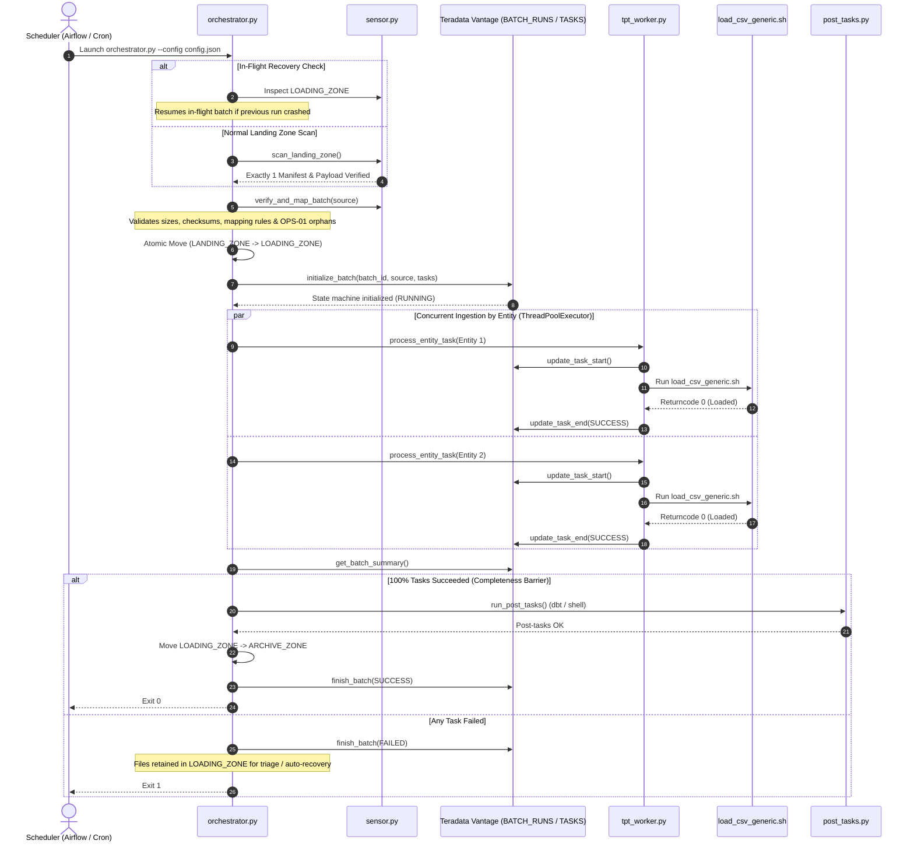

# Data Ingestion Orchestrator

[](https://www.python.org/downloads/)
[](https://www.kernel.org/)
[](https://www.teradata.com/)
[](#)

A high-performance, fault-tolerant ELT ingestion orchestrator engineered to coordinate bulk flat-file data loads (Oracle Fusion BICC extracts, multi-source enterprise CSVs) into **Teradata Vantage** using the **Generic TPT Loader**.

The orchestrator enforces a strict **Single-Batch Architecture** with atomic directory transitions, parallel entity-level worker threads, automated table unlock & retry capabilities, cryptographic checksum validation, unmanifested file boundary protection, and database-backed state persistence.

---

## Table of Contents

- [Key Features](#key-features)
- [Architecture & Workflow](#architecture--workflow)
  - [3-Tier Storage Model](#3-tier-storage-model)
  - [Lifecycle Diagram](#lifecycle-diagram)
- [Directory Layout](#directory-layout)
- [Prerequisites & Dependencies](#prerequisites--dependencies)
- [Database Setup (DDLs)](#database-setup-ddls)
- [Configuration Reference](#configuration-reference)
  - [1. Master Configuration (`config.json`)](#1-master-configuration-configjson)
  - [2. Entity Mapping Dictionary (`entity_mapping.csv`)](#2-entity-mapping-dictionary-entity_mappingcsv)
  - [3. Manifest Specification](#3-manifest-specification)
- [Execution & CLI Usage](#execution--cli-usage)
- [Operational Behaviors & Guardrails](#operational-behaviors--guardrails)
  - [Single-Batch Gating](#single-batch-gating)
  - [OPS-01 Orphan File Protection](#ops-01-orphan-file-protection)
  - [Multi-Chunk CSV Header Normalization](#multi-chunk-csv-header-normalization)
  - [In-Flight Crash Recovery](#in-flight-crash-recovery)
  - [Auto-Healing & Lock Resolution (Error 2652)](#auto-healing--lock-resolution-error-2652)
  - [Completeness Barrier & Post-Tasks](#completeness-barrier--post-tasks)
- [Logging & Monitoring](#logging--monitoring)
- [Security & Authentication](#security--authentication)
- [Troubleshooting & Exit Codes](#troubleshooting--exit-codes)

---

## Key Features

- **Strict Single-Batch Gating**: Processes exactly one batch per execution cycle, preventing race conditions, lock collisions, and multi-tenant batch contention.
- **Atomic 3-Tier Lifecycle**: Isolates batches from drop-off (`LANDING_ZONE`) to staging execution (`LOADING_ZONE`) and long-term archival (`ARCHIVE_ZONE`).
- **Source-Aware Multi-Entity Mapping**: Supports multiple independent upstream sources (e.g., `ORACLE_FUSION`, `NETSUITE`, `SALESFORCE`) feeding the same target staging table with strict source isolation.
- **Multi-Chunk Asymmetry Handling**: Detects multi-part CSV extracts, normalizes headers on-the-fly (`SkipRows=0` after strip), and loads multi-GB split extracts in a single high-speed wildcard TPT pass.
- **Enterprise Auto-Healing**: Intercepts Teradata Error 2652 (`Table is locked for FastLoad / MultiLoad`) and stalled jobs, executes automated table unlocking via `unlock_tpt_table.sh`, and resumes without redundant reloads.
- **Cryptographic & Boundary Validation**: Validates MD5 / SHA-256 manifest checksums and enforces strict boundary guards against unmanifested orphan files (OPS-01).
- **Audit State Machine**: Centralizes real-time batch and task tracking directly in Teradata technical tables (`BATCH_RUNS`, `BATCH_TASKS`).
- **Downstream Hooks**: Executes chained transformations (`dbt`, shell scripts, Python hooks) only after 100% of tasks succeed.

---

## Architecture & Workflow

### 3-Tier Storage Model

```text
[Upstream Extract] ---> LANDING_ZONE ---> (Atomic Move) ---> LOADING_ZONE ---> (TPT FastLoad) ---> Teradata Staging
                             |                                      |
                     [Sensor & Validation]                  [Worker Execution]
                             |                                      |
                             X (Reject on Error)                    v (On 100% Success)
                                                               ARCHIVE_ZONE
```

1. **`LANDING_ZONE`**: Inbound deposit directory for data extracts and batch manifests. Monitored by the sensor.
2. **`LOADING_ZONE`**: Private staging directory. Once validated, the active batch is moved here to isolate it from external modifications or concurrent arrivals.
3. **`ARCHIVE_ZONE`**: Final destination for completed batches, manifests, and audit traces.

### Lifecycle Diagram



---

## Directory Layout

```text
DATA_INGESTION_ORCHESTRATOR/
├── orchestrator.py                # Main CLI controller and execution barrier
├── config_template.json           # Template configuration file
├── entity_mapping_template.csv    # Template source-to-table dictionary
├── ddl_technical_tables.sql       # Teradata DDL script for state tracking tables
├── lib/
│   ├── db_state.py                # State machine manager (teradatasql connector)
│   ├── logger.py                  # Standardized console & dedicated run loggers
│   ├── post_tasks.py              # Extensible hook runner (dbt, shell, Python)
│   ├── sensor.py                  # Landing zone scanner, parser & boundary guard
│   └── tpt_worker.py              # Worker thread launcher with auto-healing
└── README.md                      # Technical repository documentation
```

---

## Prerequisites & Dependencies

- **Operating System**: Linux (RedHat, CentOS, Ubuntu, Debian) in production; Git Bash / WSL for Windows development.
- **Python**: Version 3.10+ (tested up to Python 3.12).
- **Python Packages**:
  ```bash
  pip install teradatasql
  ```
- **Teradata Vantage Client (TTU)**: Teradata Parallel Transporter (`tbuild`) and `bteq` must be installed and accessible in the system `$PATH`.
- **Generic TPT Loader**: `TPT_LOADER` deployed and accessible on the local filesystem.

---

## Database Setup (DDLs)

Run the DDLs in your Teradata technical schema (`<TECH_DB>`, e.g., `${TDENV}SIDFINTCH`) before launching the orchestrator:

```sql
-- 1. BATCH_RUNS: High-level execution status per batch
CREATE MULTISET TABLE <TECH_DB>.BATCH_RUNS (
    BATCH_ID            VARCHAR(100) NOT NULL,
    SOURCE              VARCHAR(50)  NOT NULL,
    EXTRACT_TIMESTAMP   TIMESTAMP(0) NOT NULL,
    RUN_DATE            DATE FORMAT 'YYYY-MM-DD' NOT NULL,
    START_TIME          TIMESTAMP(0) NOT NULL,
    END_TIME            TIMESTAMP(0),
    STATUS              VARCHAR(30)  NOT NULL
)
UNIQUE PRIMARY INDEX (BATCH_ID);

-- 2. BATCH_TASKS: Granular status of each file/entity in a batch
CREATE MULTISET TABLE <TECH_DB>.BATCH_TASKS (
    BATCH_ID            VARCHAR(100) NOT NULL,
    SOURCE              VARCHAR(50)  NOT NULL,
    EXTRACT_TIMESTAMP   TIMESTAMP(0) NOT NULL,
    ENTITY_NAME         VARCHAR(100) NOT NULL,
    FILE_NAME           VARCHAR(255) NOT NULL,
    STATUS              VARCHAR(30)  NOT NULL,
    START_TIME          TIMESTAMP(0),
    END_TIME            TIMESTAMP(0),
    RETRY_COUNT         INTEGER DEFAULT 0,
    ERROR_MESSAGE       VARCHAR(2000)
)
PRIMARY INDEX (BATCH_ID, FILE_NAME);
```

---

## Configuration Reference

### 1. Master Configuration (`config.json`)

The configuration file is organized into three decoupled functional blocks:

```json
{
  "teradata": {
    "host": "<TERADATA_HOST>",
    "user": "<USER>",
    "password": "<YourPassword>",
    "logmech": "TD2",
    "technical_database": "DEV0SIDFINTCH"
  },
  "tpt": {
    "wrapper_script": "../TPT_LOADER/load_csv_generic.sh",
    "unlock_script": "../TPT_LOADER/unlock_tpt_table.sh",
    "timeout_seconds": 3600,
    "target_db": "DEV0SIDFINSTG",
    "work_db": "DEV0SIDFINWRK",
    "default_load_mode": "replace"
  },
  "orchestration": {
    "landing_zone": "../LANDING_ZONE",
    "loading_zone": "../LOADING_ZONE",
    "archive_zone": "../ARCHIVE_ZONE",
    "logs_dir": "../LOGS",
    "max_concurrent_jobs": 5,
    "manifest_pattern": "MANIFEST_*.MF",
    "manifest_regex": "^MANIFEST_([A-Za-z0-9_]+)_(\\d{8}_\\d{6})_([A-Za-z0-9_-]+)\\.MF$",
    "entity_mapping_file": "entity_mapping.csv",
    "verify_checksum": true,
    "allow_orphan_files": false,
    "post_ingestion_tasks": [
      {
        "type": "shell",
        "command": "echo 'Batch $CURRENT_BATCH_ID completed from source $CURRENT_SOURCE'"
      }
    ]
  }
}
```

#### Parameter Breakdown

| Section | Parameter | Type | Description |
| :--- | :--- | :--- | :--- |
| **`teradata`** | `host` | String | Teradata TDPID / IP / Hostname. |
| | `user` | String | Database user for state tables. |
| | `password` | String | Password (omitted when using Wallet / `pass_file`). |
| | `pass_file` | String | Optional: encrypted password properties file path. |
| | `key_file` | String | Optional: decryption key properties file path. |
| | `logmech` | String | Teradata logon mechanism (`TD2`, `LDAP`, `KRB5`). |
| | `technical_database`| String | Target schema holding `BATCH_RUNS` and `BATCH_TASKS`. |
| **`tpt`** | `wrapper_script` | String | Path to `load_csv_generic.sh`. |
| | `unlock_script` | String | Path to `unlock_tpt_table.sh`. |
| | `timeout_seconds` | Int | Subprocess execution timeout in seconds (default: 3600). |
| | `target_db` | String | Teradata staging schema where tables reside. |
| | `work_db` | String | Teradata utility schema for TPT error/log/work tables. |
| | `default_load_mode` | String | Ingestion mode: `replace` (FastLoad) or `append` (MultiLoad). |
| **`orchestration`**| `landing_zone` | String | Inbound deposit directory path. |
| | `loading_zone` | String | Isolated staging directory path for active batch. |
| | `archive_zone` | String | Directory path for completed batches. |
| | `logs_dir` | String | Directory path for dedicated batch execution logs. |
| | `max_concurrent_jobs`| Int | Maximum parallel TPT worker threads (default: 5). |
| | `manifest_pattern` | String | Glob pattern to identify manifests (e.g. `MANIFEST_*.MF`). |
| | `manifest_regex` | String | Regex extracting `SOURCE`, `EXTRACT_TIMESTAMP`, `BATCH_ID`. |
| | `entity_mapping_file`| String | Path to `entity_mapping.csv`. |
| | `verify_checksum` | Bool | When `true`, enforces MD5/SHA256 validation from manifest. |
| | `allow_orphan_files`| Bool | When `false`, aborts if unmanifested data files exist (OPS-01).|
| | `post_ingestion_tasks`| List | Array of downstream execution hooks. |

---

### 2. Entity Mapping Dictionary (`entity_mapping.csv`)

Governs the routing of inbound filenames to Teradata target staging tables. Includes source filtering for multi-system environments:

```csv
SOURCE,TARGET_TABLE,FILE_SIGNATURE,EXTENSION
ORACLE_FUSION,ERP_AP_INVOICE_HEADER,invoiceheaderextractpvo,.csv
NETSUITE,ERP_AP_INVOICE_HEADER,vendor_bills_extract,.csv
ORACLE_FUSION,ERP_AP_INVOICE_LINES,invoicelinesextractpvo,.csv
ORACLE_FUSION,ERP_AP_INVOICE_DIST,invoicedistributionextractpvo,.csv
ORACLE_FUSION,ERP_PO_HEADERS,poheadersextractpvo,.csv
ORACLE_FUSION,ERP_PO_LINES,polinesextractpvo,.csv
ORACLE_FUSION,ERP_USER,userpvo,.csv
SALESFORCE,ERP_USER,sfdc_user_extract,.csv
*,ERP_COMMON_LOOKUP,lookup_extract,.csv
```

- **`SOURCE`**: Matches the source system parsed from the manifest filename. If empty or `*`, applies to any source.
- **`TARGET_TABLE`**: Destination Teradata table in `target_db`.
- **`FILE_SIGNATURE`**: Substring uniquely identifying the entity in the data filename.
- **`EXTENSION`**: Expected file extension (`.csv`, `.pecsv`, or `*`).

---

### 3. Manifest Specification

Manifest files must follow the naming standard:
```text
MANIFEST_<SOURCE>_<EXTRACT_TIMESTAMP>_<BATCH_ID>.MF
```
*Example*: `MANIFEST_ORACLE_FUSION_20261012_120000_1003.MF`

**File Format**: Delimited text (comma `,`, semicolon `;`, or tab `\t`) with column header:
```csv
filename,checksum
file_invoiceheaderextractpvo-batch1003-.csv,0425b5c0e17381b60178725969bcd3e7
file_userpvo-batch1003-.csv,96d3b5000de3e53b2ffb45cc3bf7ac18
```

---

## Execution & CLI Usage

Run the orchestrator from your deployment directory:

```bash
python orchestrator.py --config config.json
```

### Automation / Crontab Example

Schedule the orchestrator to run every 15 minutes:
```bash
*/15 * * * * cd /opt/elt/orchestrator && /usr/bin/python3 orchestrator.py --config config.json >> /var/log/elt_cron.log 2>&1
```

If the landing zone contains no batches, the orchestrator exits immediately with Return Code `0` without creating database records.

---

## Operational Behaviors & Guardrails

### Single-Batch Gating
- **Zero Manifests & Zero Files**: Exits gracefully (`RC 0`).
- **Files Present without Manifest**: Fails fast (`RC 1`) to avoid processing partial/uncommitted uploads.
- **Multiple Manifests Present**: Fails fast (`RC 1`) with `ERROR_MULTIPLE_MANIFESTS`. Enforces single-batch queuing to guarantee deterministic throughput and prevent lock contention.

### OPS-01 Orphan File Protection
If a data file exists in `LANDING_ZONE` that is not referenced in the manifest, the orchestrator immediately raises a `Boundary violation (OPS-01)` error and halts before moving any files to `LOADING_ZONE`.

### Multi-Chunk CSV Header Normalization
When an entity extract is split across multiple chunk files (e.g., `part1.csv`, `part2.csv`):
1. The orchestrator inspects the first chunk in `LOADING_ZONE`.
2. It strips the CSV header row in-place and leaves a hidden marker file (`.<filename>.header_stripped`).
3. TPT is then invoked across all chunks via a wildcard pattern with `-S 0` (SkipRows=0). This ensures zero data loss and prevents header lines from contaminating data tables.

### In-Flight Crash Recovery
If the orchestrator process or server is terminated mid-execution:
1. Validated files remain safe inside `LOADING_ZONE`.
2. On next launch, the orchestrator detects the in-flight manifest in `LOADING_ZONE` and automatically resumes.
3. Checksum verification and file moving are bypassed, and pending/failed tasks in `BATCH_TASKS` are resumed seamlessly.

### Auto-Healing & Lock Resolution (Error 2652)
- **Pre-emptive Unlock**: If a task has `RETRY_COUNT > 0`, the worker executes `unlock_tpt_table.sh` before invoking TPT to clear stale locks left by preceding crashes.
- **Reactive Unlock**: If TPT reports Error 2652 (`Table is locked for FastLoad / MultiLoad`), the worker intercepts the error, runs `unlock_tpt_table.sh`, and resolves the lock automatically.

### Completeness Barrier & Post-Tasks
Post-ingestion tasks are executed **only if 100% of entity tasks reach `SUCCESS`**:
- Environment variables `$CURRENT_BATCH_ID`, `$CURRENT_SOURCE`, and `$CURRENT_MANIFEST` are dynamically exported to child processes.
- Once post-tasks succeed, all files are moved atomically from `LOADING_ZONE` to `ARCHIVE_ZONE`, and `BATCH_RUNS` is updated to `SUCCESS`.

---

## Logging & Monitoring

- **Console Output**: Real-time structured log stream with timestamps and log levels.
- **Dedicated Batch Run Logs**: Automatically generated in `logs_dir` (`../LOGS`):
  ```text
  LOGS/orchestrator_<SOURCE>_<EXTRACT_TIMESTAMP>_<BATCH_ID>_<RUN_TIMESTAMP>.log
  ```
- **Database Audit Trail**: Queryable at any time in Teradata:
  ```sql
  SELECT * FROM DEV0SIDFINTCH.BATCH_RUNS ORDER BY START_TIME DESC;
  SELECT * FROM DEV0SIDFINTCH.BATCH_TASKS WHERE BATCH_ID = '1003';
  ```

---

## Security & Authentication

- **Teradata Wallet**: In production environments, passwords should not be stored in configuration files. Configure Teradata Wallet (`$tdwallet`) for the service account, and omit the `password` field from `config.json`.
- **Encrypted Password Files**: Supported via `pass_file` and `key_file` in the `teradata` configuration block.
- **Environment Isolation**: Subprocesses only receive required Teradata connection variables (`TDPID`, `TD_PASSWORD`, `SID_ADM_USER`).

---

## Troubleshooting & Exit Codes

| Exit Code | Cause | Recommended Action |
| :---: | :--- | :--- |
| `0` | Batch completed successfully, or Landing Zone is empty (`IDLE`). | Normal operation. |
| `1` | Validation error, boundary violation, missing manifest, or TPT job failure. | Inspect the batch run log in `LOGS/` and `BATCH_TASKS` table in Teradata. |

### Common Error Patterns

- **`FATAL: Found X data files... but no manifest`**: Upstream upload is still transferring, or manifest creation failed. Ensure manifests are uploaded *after* data files.
- **`Single-Batch rule violation: Multiple manifests detected`**: More than one batch dropped simultaneously. Archive or process older manifests sequentially.
- **`Checksum mismatch for '<file>'`**: File corruption during transmission. Verify file size and re-export extract.
- **`Boundary violation (OPS-01)`**: An unmanifested file is present in landing zone. Remove orphan file or update the manifest.
