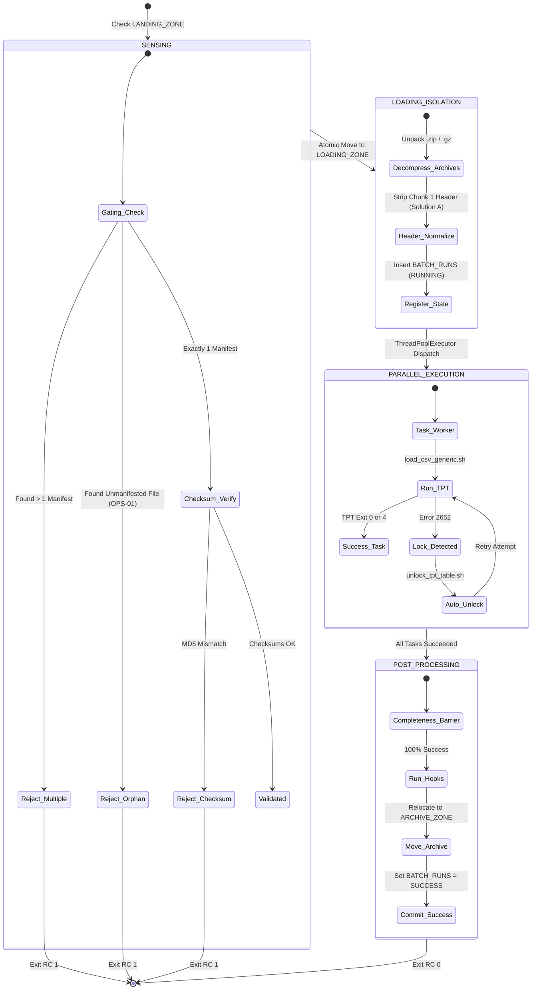

# Data Ingestion Orchestrator

[](https://www.python.org/downloads/)
[](https://www.kernel.org/)
[](https://www.teradata.com/)
[](#)

A high-performance, fault-tolerant ELT ingestion orchestrator engineered to coordinate bulk flat-file data loads (Oracle Fusion BICC extracts, multi-source enterprise CSVs) into **Teradata Vantage** using the **Generic TPT Loader**.

The orchestrator enforces a strict **Single-Batch Architecture** with atomic directory transitions, parallel entity-level worker threads, automated table unlock & retry capabilities, cryptographic checksum validation, unmanifested file boundary protection, and database-backed state persistence.

---

## 📚 Complete Documentation Suite

Comprehensive operational, technical, and testing manuals are available in the [`docs/`](docs/) directory:

- 📖 **[User How-To & Configuration Guide](docs/01_user_how_to_guide.md)**: Command-line syntax, complete `config.json` reference, log inspection, and troubleshooting runbooks.
- 📐 **[Functional Specification](docs/02_functional_specification.md)**: Plain-English architecture, OPS-01 single-batch gating, Solution A multi-chunk header stripping, and barrier logic.
- ⚙️ **[Technical Manual & Function Inventory](docs/03_technical_manual_and_inventory.md)**: Module breakdowns (`sensor`, `db_state`, `tpt_worker`, `post_tasks`), state machine DDL, and concurrency design.
- 🧪 **[Testing, Validation & QA Guide](docs/04_testing_and_qa_guide.md)**: Test matrices, orphan file injection, Error 2652 reactive lock recovery tests, and automated regression harnesses.

---

## Table of Contents

- [Key Features](#key-features)
- [Architecture & Workflow](#architecture--workflow)
  - [3-Tier Storage Model](#3-tier-storage-model)
  - [Lifecycle Diagram](#lifecycle-diagram)
- [Directory Layout](#directory-layout)
- [Prerequisites & Dependencies](#prerequisites--dependencies)
- [Database Setup (DDLs)](#database-setup-ddls)
- [Configuration Reference](#configuration-reference)
  - [1. Master Configuration (`config.json`)](#1-master-configuration-configjson)
  - [2. Entity Mapping Dictionary (`entity_mapping.csv`)](#2-entity-mapping-dictionary-entity_mappingcsv)
  - [3. Manifest Specification](#3-manifest-specification)
- [Execution & CLI Usage](#execution--cli-usage)
- [Operational Behaviors & Guardrails](#operational-behaviors--guardrails)
  - [Single-Batch Gating](#single-batch-gating)
  - [OPS-01 Orphan File Protection](#ops-01-orphan-file-protection)
  - [Multi-Chunk CSV Header Normalization](#multi-chunk-csv-header-normalization)
  - [In-Flight Crash Recovery](#in-flight-crash-recovery)
  - [Auto-Healing & Lock Resolution (Error 2652)](#auto-healing--lock-resolution-error-2652)
  - [Completeness Barrier & Post-Tasks](#completeness-barrier--post-tasks)
- [Logging & Monitoring](#logging--monitoring)
- [Security & Authentication](#security--authentication)
- [Troubleshooting & Exit Codes](#troubleshooting--exit-codes)

---

## Key Features

- **Strict Single-Batch Gating**: Processes exactly one batch per execution cycle, preventing race conditions, lock collisions, and multi-tenant batch contention.
- **Atomic 3-Tier Lifecycle**: Isolates batches from drop-off (`LANDING_ZONE`) to staging execution (`LOADING_ZONE`) and long-term archival (`ARCHIVE_ZONE`).
- **Source-Aware Multi-Entity Mapping**: Supports multiple independent upstream sources (e.g., `ORACLE_FUSION`) feeding target staging tables with strict source isolation and inner extension awareness (`.csv` vs `.pecsv`).
- **Multi-Chunk Asymmetry Handling**: Detects multi-part CSV extracts, normalizes headers on-the-fly (`SkipRows=0` after chunk 1 strip), and loads split extracts in a single high-speed wildcard TPT pass.
- **Enterprise Auto-Healing**: Intercepts Teradata Error 2652 (`Table is locked for FastLoad / MultiLoad`), executes automated table unlocking via `unlock_tpt_table.sh`, and retries without manual intervention.
- **Single-Flight Concurrency & Active Polling**: Manages `.orchestrator.pid` in `LOADING_ZONE`; actively polls on live PIDs until release, avoiding concurrent job collision.
- **Cryptographic & Boundary Validation**: Validates MD5 manifest checksums and enforces strict boundary guards against unmanifested orphan files (OPS-01).
- **Permanent Audit State Machine**: Centralizes real-time batch and task tracking directly in Teradata technical tables (`BATCH_RUNS`, `BATCH_TASKS`). Permanently retains `PROCESS_PID` upon completion for historical lineage.
- **Downstream Hooks & Hybrid Decoupling**: Merges source-specific tasks (`--post-tasks-file`) with global tasks (`post_ingestion_tasks`); bypasses execution cleanly when `--skip-post-tasks` is specified.

---

## Architecture & Workflow

### 3-Tier Storage Model

```text
[Upstream Extract] ---> LANDING_ZONE ---> (Atomic Move) ---> LOADING_ZONE ---> (TPT FastLoad) ---> Teradata Staging
                             |                                      |
                     (Strict Gate: 1 MF)                    (Decompress & Strip)
                                                                    |
                                                            (100% Barrier OK)
                                                                    |
                                                                    v
                                                              ARCHIVE_ZONE
```

### Lifecycle Diagram



---

## Configuration Reference

### Master Configuration (`config.json`)

The orchestrator configuration uses portable relative paths and environment variable expansion:

```json
{
  "teradata": {
    "host": "${TDPID}",
    "user": "${TDENV}${SID_ADM_USER}",
    "logmech": "TD2",
    "technical_database": "${TDENV}SIDFINTCH"
  },
  "tpt": {
    "wrapper_script": "../TPT_LOADER/load_csv_generic.sh",
    "unlock_script": "../TPT_LOADER/unlock_tpt_table.sh",
    "timeout_seconds": 3600,
    "target_db": "${TDENV}SIDFINSTG",
    "work_db": "${TDENV}SIDFINWRK",
    "default_load_mode": "replace"
  },
  "orchestration": {
    "landing_zone": "../../DATA/LANDING_ZONE",
    "loading_zone": "../../DATA/LOADING_ZONE",
    "archive_zone": "../../DATA/ARCHIVE_ZONE",
    "logs_dir": "../../LOGS",
    "max_concurrent_jobs": 4,
    "manifest_pattern": "MANIFEST_*.MF",
    "manifest_regex": "^MANIFEST_([A-Za-z0-9_]+)_(\\d{8}_\\d{6})_([A-Za-z0-9_-]+)\\.MF$",
    "entity_mapping_file": "../../CONFIG/entity_mapping.csv",
    "verify_checksum": true,
    "allow_orphan_files": false,
    "post_ingestion_tasks": [
      {
        "type": "shell",
        "command": "echo 'Ingestion completed for batch $CURRENT_BATCH_ID from source $CURRENT_SOURCE'"
      }
    ]
  }
}
```

---

## Entity Mapping Dictionary (`entity_mapping.csv`)

```csv
SOURCE,TARGET_TABLE,FILE_SIGNATURE,EXTENSION,INNER_EXTENSION
ORACLE_FUSION,ERP_MSH_INVOICE_HEADER,invoiceheaderextractpvo,".csv,.zip,.gz,.csv.gz",.csv
ORACLE_FUSION,ERP_MSH_INVOICE_HEADER_AK,invoiceheaderextractpvo,".pecsv,.zip,.gz,.pecsv.gz",.pecsv
ORACLE_FUSION,ERP_MSH_USER,userpvo,".csv,.zip,.gz,.csv.gz",.csv
ORACLE_FUSION,ERP_MSH_USER_AK,userpvo,".pecsv,.zip,.gz,.pecsv.gz",.pecsv
```

---

## Execution & CLI Usage

### Standard Orchestrator Run
```bash
python3 orchestrator.py --config config.json
```

### Ingestion with Post-Tasks Skipped
```bash
python3 orchestrator.py --config config.json --skip-post-tasks
```

### Source-Specific / Delegated Ingestion
```bash
python3 orchestrator.py --config config.json --source <SOURCE> --post-tasks-file /path/to/post_tasks.json
```

If `LANDING_ZONE` is empty, the orchestrator exits cleanly with Return Code `0` (`IDLE`).

---

## Troubleshooting & Exit Codes

| Exit Code | Meaning | Action |
| :---: | :--- | :--- |
| `0` | Batch ingested and archived successfully, or `LANDING_ZONE` is empty (`IDLE`). | Normal operation. |
| `1` | OPS-01 violation (orphans / multiple manifests), checksum failure, or TPT task error. | Inspect `LOGS/orchestrator_*.log` and Teradata `BATCH_TASKS` table. |

For detailed failure scenarios, error runbooks, and recovery instructions, consult **[docs/01_user_how_to_guide.md](docs/01_user_how_to_guide.md)**.
