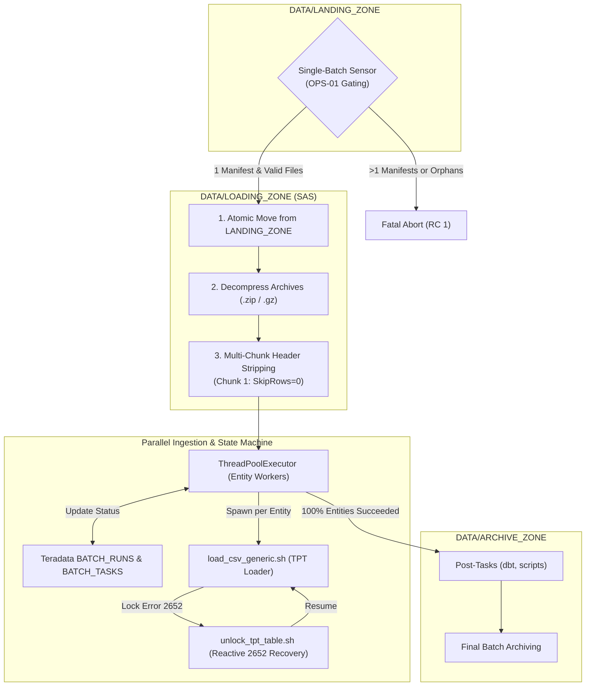

# DATA_INGESTION_ORCHESTRATOR - User How-To & Configuration Guide

## 1. Overview & Operational Role

The **DATA_INGESTION_ORCHESTRATOR** (`orchestrator.py`) is the Tier-2 engine supervisor of the `DATA_LOADER` framework. It implements a strict **Single-Batch Architecture**: it ingests exactly one manifested batch per execution, guaranteeing complete transaction boundaries, isolated worker processing, and detailed state tracking in Teradata Vantage.



---

## 2. Prerequisites & Environment Setup

### 2.1 Dependencies
- **Python**: Python 3.8+ (standard library: `concurrent.futures`, `json`, `argparse`, `shutil`, `zipfile`, `gzip`, `hashlib`).
- **Teradata Driver**: `teradatasql` (for state tracking against `${TDENV}SIDFINTCH`).
- **TPT Loader**: Executable bash script `TPT_LOADER/load_csv_generic.sh`.
- **Teradata TTU**: `tbuild` and `bteq` available on the system `$PATH`.

### 2.2 Unix Environment Variables
The orchestrator leverages the standard profile exports:
```bash
export TDENV="DEV0"
export TDPID="tdadev"
export SID_ADM_USER="SIDFINADM"
export LANG="C"
```

---

## 3. Command-Line Syntax & Execution

### 3.1 Invocation Syntax
```bash
python3 orchestrator.py --config <path_to_config.json> [--skip-post-tasks] [--source <SOURCE>] [--post-tasks-file <FILE>]
```

| Parameter | Required | Type | Description |
|---|---|---|---|
| `--config` | **Yes** | String | Path to the orchestrator JSON configuration file. |
| `--skip-post-tasks` | No | Flag | Bypasses all post-ingestion tasks (both source-specific and global dbt/analytics models). |
| `--source` | No | String | Source system partition code (e.g. `ORACLE_FUSION`, `CRM`). Isolates the landing and loading zones. |
| `--post-tasks-file` | No | String | Path to a JSON file containing source-specific post-tasks generated by an upstream Feeder. Merged with global tasks. |

### 3.2 Execution Modes

#### Standard Automated Run (Invoked by Feeder)
Normally, `feeder.py` invokes the orchestrator automatically, forwarding `--skip-post-tasks`, `--source`, and `--post-tasks-file`:
```bash
cd /sg/local/sid/home/Dsidadm/DATA_LOADER/PROCESSING_TOOLS/DATA_INGESTION_ORCHESTRATOR
python3 orchestrator.py --config config.json
```

#### Selective Ingestion Run (Post-Tasks Bypassed)
Run Orchestrator directly on a staged batch in `LANDING_ZONE` while skipping post-load hooks:
```bash
python3 orchestrator.py --config config.json --skip-post-tasks
```

#### Manual In-Flight Recovery
If a previous execution was interrupted while files were inside `LOADING_ZONE`, executing `orchestrator.py` immediately discovers the uncompleted batch and resumes from the point of failure:
```bash
python3 orchestrator.py --config config.json
```

---

## 4. Configuration Reference (`config.json`)

### 4.1 Production Configuration Schema
```json
{
  "orchestration": {
    "landing_zone": "../../DATA/LANDING_ZONE",
    "loading_zone": "../../DATA/LOADING_ZONE",
    "archive_zone": "../../DATA/ARCHIVE_ZONE",
    "logs_dir": "../../LOGS",
    "entity_mapping_file": "../../CONFIG/entity_mapping.csv",
    "max_concurrent_entities": 4,
    "max_retries_per_entity": 1,
    "verify_checksum": true,
    "allow_orphan_files": false
  },
  "tpt": {
    "wrapper_script": "../TPT_LOADER/load_csv_generic.sh",
    "unlock_script": "../TPT_LOADER/unlock_tpt_table.sh",
    "default_load_mode": "replace",
    "target_database": "${TDENV}SIDFINSTG",
    "work_database": "${TDENV}SIDFINWRK",
    "logon_user": "${TDENV}${SID_ADM_USER}",
    "error_limit": 1,
    "max_sessions": 8,
    "reader_instances": 1,
    "load_instances": 1,
    "work_dir": "../../LOGS/tpt_work"
  },
  "teradata": {
    "host": "${TDPID}",
    "user": "${TDENV}${SID_ADM_USER}",
    "technical_database": "${TDENV}SIDFINTCH",
    "logmech": "TD2"
  },
  "post_tasks": [
    {
      "name": "Audit Logging",
      "type": "shell",
      "command": "echo 'Ingestion completed for batch {batch_id} from source {source}'"
    }
  ]
}
```

### 4.2 Parameter Specification

#### `orchestration` Block
| Parameter | Type | Default | Description |
|---|---|---|---|
| `landing_zone` | String | `../../DATA/LANDING_ZONE` | Single-batch ingress gate. |
| `loading_zone` | String | `../../DATA/LOADING_ZONE` | Private staging directory where decompression and header stripping occur. |
| `archive_zone` | String | `../../DATA/ARCHIVE_ZONE` | Final resting place for completed batches. |
| `logs_dir` | String | `../../LOGS` | Log directory. |
| `entity_mapping_file` | String | `../../CONFIG/entity_mapping.csv` | File routing CSV mapping file signatures to target staging tables. |
| `max_concurrent_entities` | Integer | `4` | Number of worker threads executing TPT in parallel. |
| `max_retries_per_entity` | Integer | `1` | Automatic retry attempts per failed entity before marking batch failed. |
| `verify_checksum` | Boolean | `true` | When `true`, validates MD5/SHA256 checksums declared in the manifest. |
| `allow_orphan_files` | Boolean | `false` | When `false` (OPS-01 invariant), rejects batches if unmanifested files exist in `LANDING_ZONE`. |

#### `tpt` Block
| Parameter | Type | Default | Description |
|---|---|---|---|
| `wrapper_script` | String | `../TPT_LOADER/load_csv_generic.sh` | Path to generic TPT runner script. |
| `unlock_script` | String | `../TPT_LOADER/unlock_tpt_table.sh` | Path to table unlock script (Error 2652). |
| `default_load_mode` | String | `replace` | Ingestion mode: `replace` (FastLoad DELETE ALL) or `append` (MultiLoad). |
| `target_database` | String | `${TDENV}SIDFINSTG` | Target staging database. |
| `work_database` | String | `${TDENV}SIDFINWRK` | Database for TPT utility tables (`LG_`, `ET_`, `UV_`, `WT_`). |
| `logon_user` | String | `${TDENV}${SID_ADM_USER}` | User credential for TPT execution. |
| `max_sessions` | Integer | `8` | Maximum Teradata sessions allocated per TPT job. |
| `work_dir` | String | `../../LOGS/tpt_work` | Dedicated working and log directory passed to TPT via `-w` (stores jobvars, rejected rows, and tbuild output). |

---

## 5. Monitoring & Operational Inspection

### 5.1 Batch Log Naming Convention
Every run generates a dedicated, batch-specific log file:
```
../../LOGS/orchestrator_<SOURCE>_<EXTRACT_TS>_<BATCH_ID>_<RUN_TS>.log
```
Example:
```
orchestrator_ORACLE_FUSION_20261015_120011_000000011_20261015_120921.log
```

### 5.2 Tracking State in Teradata
Query the central technical catalog in `${TDENV}SIDFINTCH`:

```sql
-- Check Batch Run status
SELECT BATCH_ID, SOURCE, EXTRACT_TIMESTAMP, RUN_DATE, START_TIME, END_TIME, STATUS
FROM DEV0SIDFINTCH.BATCH_RUNS
ORDER BY RUN_DATE DESC, START_TIME DESC;

-- Check Entity Task status
SELECT BATCH_ID, ENTITY_NAME, FILE_NAME, STATUS, START_TIME, END_TIME, RETRY_COUNT, ERROR_MESSAGE
FROM DEV0SIDFINTCH.BATCH_TASKS
WHERE BATCH_ID = '000000011'
ORDER BY START_TIME ASC;
```

---

## 6. Troubleshooting Runbook

### Failure Mode 1: Boundary Violation (OPS-01) - Unmanifested Files
- **Symptom**:
  ```text
  ValueError: Boundary violation (OPS-01): Unmanifested orphan file(s) found in landing zone: ['stray_file.csv']
  ```
- **Root Cause**: A data file exists in `LANDING_ZONE` that is not declared in the manifest.
- **Resolution**:
  1. Inspect `LANDING_ZONE` for unmanifested files:
     ```bash
     ls -la /sg/local/sid/home/Dsidadm/DATA_LOADER/DATA/LANDING_ZONE/
     ```
  2. If the orphan file belongs to the batch, update the manifest in `DROP_ZONE` and re-run.
  3. If it is an accidental stray file, quarantine it:
     ```bash
     mv /sg/local/sid/home/Dsidadm/DATA_LOADER/DATA/LANDING_ZONE/stray_file.csv /tmp/quarantine/
     ```

---

### Failure Mode 2: Teradata Table Locked (Error 2652)
- **Symptom**:
  ```text
  TPT Job failed with error 2652: Operation not allowed: table is being Loaded / Paused.
  ```
- **Automated Behavior**: The orchestrator automatically invokes `unlock_tpt_table.sh -t <TABLE> -m <MODE>` and retries the entity task up to `max_retries_per_entity`.
- **Manual Resolution (if retries exhausted)**:
  Run the unlock tool directly:
  ```bash
  cd /sg/local/sid/home/Dsidadm/DATA_LOADER/PROCESSING_TOOLS/TPT_LOADER
  ./unlock_tpt_table.sh -t ERP_MSH_INVOICE_HEADER -m replace -d DEV0SIDFINSTG -u DEV0SIDFINADM
  ```

---

### Failure Mode 3: Checksum Mismatch
- **Symptom**:
  ```text
  ValueError: Checksum mismatch for 'file_userpvo-batch000000011.csv': expected 3a7426..., computed cb4d70...
  ```
- **Root Cause**: The file was corrupted during transit, or modified after manifest generation.
- **Resolution**:
  1. The orchestrator halts immediately before executing any TPT jobs or touching the target database.
  2. Verify source file integrity in `DROP_ZONE/ARCHIVE/` or re-extract from Oracle Fusion BICC.
