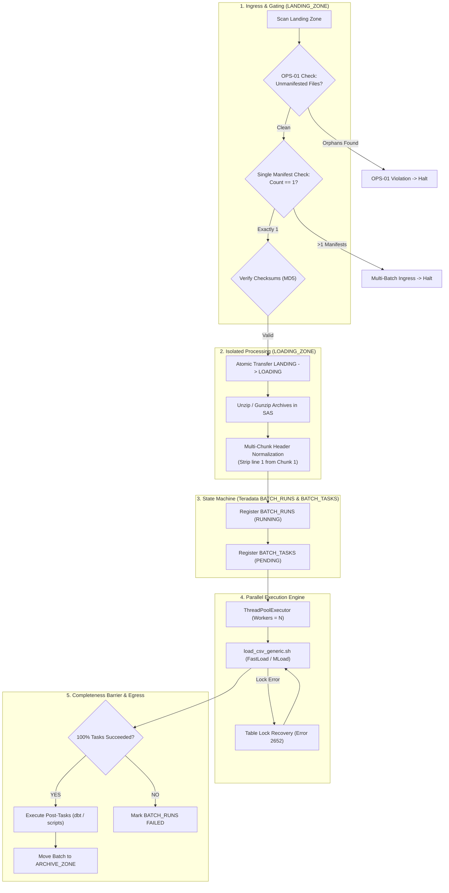
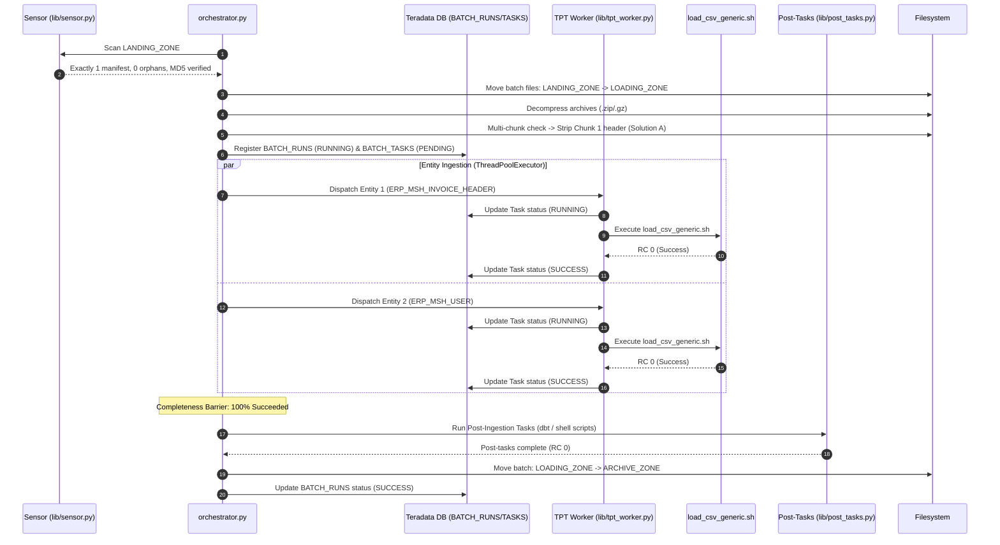

# DATA_INGESTION_ORCHESTRATOR - Functional Specification

## 1. Business & Functional Objective

The **DATA_INGESTION_ORCHESTRATOR** governs the physical staging of validated batches into **Teradata Vantage**. Operating under a strict **Single-Batch Contract**, it coordinates file decompression, header normalization, parallel worker invocation, database state tracking, post-ingestion pipeline hooks, and atomic file archiving.



---

## 2. Core Functional Responsibilities

### What the Orchestrator Does:
1. **Single-Batch Gating (OPS-01)**: Enforces that exactly one manifest file is present in `LANDING_ZONE` and rejects any batch containing unmanifested orphan files.
2. **Cryptographic Validation**: Verifies that every manifested file exists, is non-empty ($>0$ bytes), and matches its declared MD5 checksum.
3. **Atomic Isolation Transfer**: Moves the entire validated batch into `DATA/LOADING_ZONE` prior to processing, guaranteeing that failed or aborted runs do not pollute `LANDING_ZONE`.
4. **Decompression & Extraction**: Decompresses `.zip` and `.gz` archives safely within `LOADING_ZONE`, preserving `.csv` (payload) and `.pecsv` (active keys) files.
5. **Multi-Chunk Header Normalization (Solution A)**:
   - When an entity consists of multiple chunk files (e.g. `part1.csv`, `part2.csv`), it strips the header from Chunk 1 in-place, writes a `.<file>.header_stripped` marker, and invokes TPT with wildcard pattern and `SkipRows = 0`.
   - Single-file entities retain their headers and load with `SkipRows = 1`.
6. **State Machine Management**: Tracks batch lifecycle in Teradata Vantage tables (`${TDENV}SIDFINTCH.BATCH_RUNS` and `BATCH_TASKS`).
7. **Parallel Worker Execution**: Dispatches entity loading tasks concurrently using `ThreadPoolExecutor`.
8. **Lock Recovery**: Automatically recovers from Teradata Error 2652 (FastLoad/MultiLoad paused) via `unlock_tpt_table.sh`.
9. **100% Completeness Barrier**: Requires every entity task to succeed before triggering downstream post-tasks or archiving.

---

## 3. End-to-End Processing Sequence



---

## 4. Ingestion Invariants & Architectural Rules

### 4.1 Invariant OPS-01: Single-Batch Gate
The orchestrator operates on a strict single-batch contract:
- If `0` manifests and `0` files exist: Exits cleanly with return code `0` (IDLE).
- If `>1` manifests are detected: Aborts immediately with return code `1`.
- If data files are present without a manifest: Aborts immediately with return code `1`.
- If unmanifested files (orphans) exist alongside a manifest: Aborts immediately with return code `1`.

### 4.2 Invariant Solution A: Multi-Chunk Header Normalization
When loading multi-part CSV extracts into Teradata using wildcards (`*signature*.csv`), Teradata TPT's `SkipRows` attribute creates a fundamental dilemma:
- If `SkipRows = 1` is applied across a wildcard, TPT skips line 1 of every chunk. If chunk 2 does not have a header, valid data rows are lost.
- If `SkipRows = 0` is applied, chunk 1's header line is treated as data, causing conversion errors.

**Solution A Resolution**:
1. When multiple chunks are detected, `strip_header_in_place()` removes line 1 of Chunk 1 in-place.
2. A hidden marker file (`.chunk1.csv.header_stripped`) is written to guarantee idempotency on retries.
3. TPT is invoked with wildcard pattern `*signature*.csv` and `SkipRows = 0`.
4. Single-chunk files are untouched and ingested with `SkipRows = 1`.

---

## 5. Teradata State Machine Tracking

Batch and entity lifecycles are persisted in `${TDENV}SIDFINTCH`:

### `BATCH_RUNS` Table
Tracks global batch state:
- `BATCH_ID`: Unique batch identifier.
- `SOURCE`: Source system code (e.g. `ORACLE_FUSION`).
- `EXTRACT_TIMESTAMP`: Manifest extract timestamp.
- `RUN_DATE`: Execution date (`YYYY-MM-DD`).
- `START_TIME` / `END_TIME`: Timestamps (`YYYY-MM-DD HH:MM:SS`).
- `STATUS`: State transitions: `RUNNING` $\rightarrow$ `SUCCESS` or `FAILED`.

### `BATCH_TASKS` Table
Tracks granular entity tasks:
- `ENTITY_NAME`: Target staging table (e.g. `ERP_MSH_INVOICE_HEADER`).
- `FILE_NAME`: Input file name or wildcard pattern.
- `STATUS`: `PENDING` $\rightarrow$ `RUNNING` $\rightarrow$ `SUCCESS` or `FAILED`.
- `RETRY_COUNT`: Number of retry attempts.
- `ERROR_MESSAGE`: Failure diagnostics if applicable.

---

## 6. Post-Ingestion Hooks & Final Archiving

### 6.1 Completeness Barrier
Downstream processing will never trigger if even one entity task fails:
$$\text{Execution Condition} = \left(\frac{\text{Successful Tasks}}{\text{Total Tasks}} = 1.00\right)$$

### 6.2 Post-Tasks Execution
Configured under `post_tasks` in `config.json`. Supports:
- **Shell Scripts**: Custom validation scripts, notifications, or file cleanup.
- **dbt Transformations**: Downstream ELT models (`dbt run --select staging.oracle_fusion`).

### 6.3 Archiving to `ARCHIVE_ZONE`
Upon 100% completion of tasks and post-tasks:
1. Decompressed temporary files (`.tmp`, `.header_stripped`) are cleaned up.
2. The manifest and payload data files are moved from `DATA/LOADING_ZONE/<SOURCE>/` into the Batch Capsule:
   ```
   DATA/ARCHIVE_ZONE/<SOURCE>/<YYYY-MM>/BATCH_<ID>_<TS>/
   ```
3. `BATCH_RUNS.STATUS` is committed as `SUCCESS`, while retaining `PROCESS_PID` for permanent auditability.
