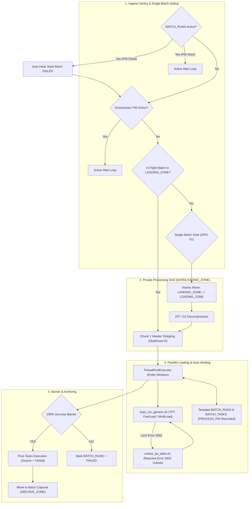
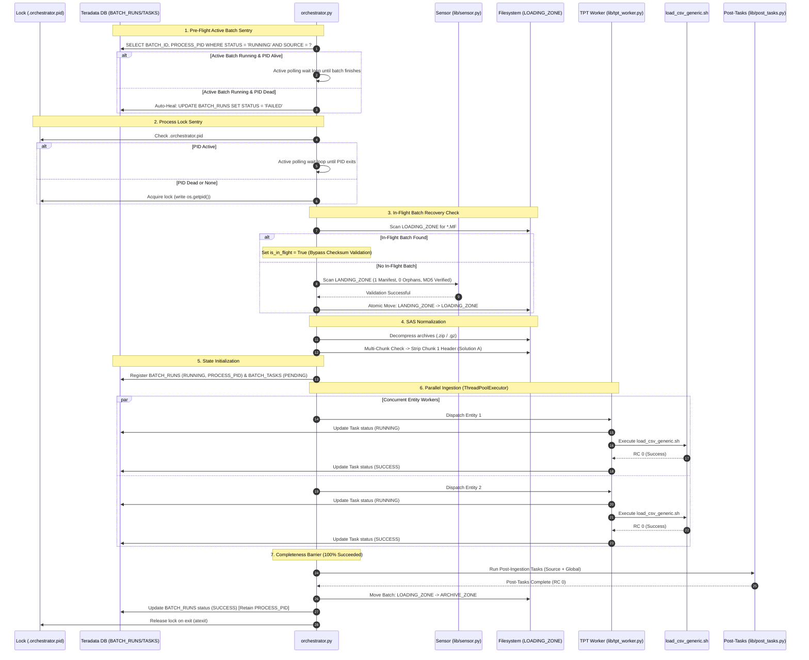

# DATA_INGESTION_ORCHESTRATOR - Functional Specification

## 1. Business & Functional Objective

The **DATA_INGESTION_ORCHESTRATOR** serves as the Tier-2 ingestion engine for the **DATA_LOADER** flat-file ELT ecosystem feeding Teradata Vantage.

### System Purpose
The orchestrator bridges upstream ingress preparation with high-speed Teradata utility loaders (TPT FastLoad / MultiLoad). It operates under a strict **Single-Batch Architecture**: it ingests exactly one manifested batch per execution cycle, guaranteeing total data isolation, deterministic crash resumption, and granular state tracking in Teradata Vantage.



---

## 2. Core Functional Responsibilities

### What the Orchestrator Does:
1. **Single-Flight Process Concurrency**: Manages `.orchestrator.pid` in `LOADING_ZONE/<SOURCE>` and queries `${TDENV}SIDFINTCH.BATCH_RUNS` to guarantee that only one orchestrator process loads data for a given source at any moment.
2. **Automated In-Flight Crash Resumption**: Detects uncompleted batches in `LOADING_ZONE/<SOURCE>` from crashed runs, bypasses checksum re-verification, resumes only pending/failed tasks, and completes the lifecycle through archiving.
3. **Single-Batch Gating (OPS-01)**: Enforces that exactly one manifest file is present in `LANDING_ZONE/<SOURCE>` and rejects any batch containing unmanifested orphan files.
4. **Cryptographic Validation**: Verifies that every manifested file exists, is non-empty ($>0$ bytes), and matches its declared MD5 checksum.
5. **Atomic Isolation Transfer**: Moves the entire validated batch into `DATA/LOADING_ZONE/<SOURCE>` prior to processing, guaranteeing that failed or aborted runs do not pollute `LANDING_ZONE`.
6. **Decompression & Extraction**: Decompresses `.zip` and `.gz` archives safely within `LOADING_ZONE`, preserving `.csv` (payload) and `.pecsv` (active keys) files.
7. **Multi-Chunk Header Normalization (Solution A)**:
   - When an entity consists of multiple chunk files (e.g. `part1.csv`, `part2.csv`), it strips the header from Chunk 1 in-place, writes a `.<file>.header_stripped` marker, and invokes TPT with wildcard pattern and `SkipRows = 0`.
   - Single-file entities retain their headers and load with `SkipRows = 1`.
8. **State Machine Management**: Tracks batch lifecycle in Teradata Vantage tables (`${TDENV}SIDFINTCH.BATCH_RUNS` and `BATCH_TASKS`), permanently recording and retaining `PROCESS_PID` upon completion.
9. **Parallel Worker Execution**: Dispatches entity loading tasks concurrently using `ThreadPoolExecutor`.
10. **Reactive Lock Recovery**: Automatically recovers from Teradata Error 2652 (FastLoad/MultiLoad paused) via `unlock_tpt_table.sh`.
11. **100% Completeness Barrier**: Requires every entity task to succeed before triggering downstream post-tasks or archiving.

---

## 3. End-to-End Processing Sequence



---

## 4. Ingestion Invariants & Architectural Rules

### 4.1 Invariant OPS-01: Single-Batch Gate
The orchestrator operates on a strict single-batch contract:
- If `LANDING_ZONE` contains 0 manifests and 0 files, it exits cleanly with Return Code `0` (`IDLE`).
- If `LANDING_ZONE` contains $>1$ manifest files, it aborts immediately with Return Code `1`.
- If `LANDING_ZONE` contains data files without a manifest, it aborts immediately with Return Code `1`.

### 4.2 Invariant OPS-02: Zero Unmanifested Orphans
Every file present in `LANDING_ZONE` must be explicitly declared in the manifest:
$$\text{Files}_{\text{LandingZone}} \setminus \{\text{Manifest}\} \subseteq \text{Files}_{\text{Manifest}}$$
If any undeclared file is detected, validation fails immediately before moving files or altering databases.

### 4.3 Invariant OPS-03: Single-Flight Process Concurrency
To eliminate race conditions and prevent concurrent TPT loads from deadlocking Teradata with Error 2652:
- Only one orchestrator may execute per source partition at any time.
- Mutual exclusion is enforced via `.orchestrator.pid` in `LOADING_ZONE/<SOURCE>` and `BATCH_RUNS` state checks.
- When an active run is detected, incoming processes poll every `poll_interval_seconds` (default: 5s) up to `lock_timeout_seconds` (default: 7200s).

### 4.4 Invariant OPS-04: Automated In-Flight Crash Resumption
If an orchestrator execution terminates abruptly after files have moved into `LOADING_ZONE`:
- Subsequent invocations discover the in-flight manifest in `LOADING_ZONE/<SOURCE>`.
- Checksum re-validation is skipped (`verify_checksum = False`) because archives may already be decompressed and headers stripped.
- The state database identifies already-succeeded tasks vs pending/failed tasks, resuming only incomplete work.
- Upon full completion, the in-flight batch is moved to `ARCHIVE_ZONE`, freeing `LOADING_ZONE` for new batches.

---

## 5. Technical Tables in Teradata (`${TDENV}SIDFINTCH`)

### `BATCH_RUNS` Table
Tracks batch-level lifecycle, execution timestamps, status, and OS Process ID:
```sql
CREATE MULTISET TABLE DEV0SIDFINTCH.BATCH_RUNS ,NO FALLBACK ,
     NO BEFORE JOURNAL,
     NO AFTER JOURNAL,
     CHECKSUM = DEFAULT,
     DEFAULT MERGEBLOCKRATIO
     (
        BATCH_ID VARCHAR(100) CHARACTER SET UNICODE NOT CASESPECIFIC NOT NULL,
        SOURCE VARCHAR(50) CHARACTER SET UNICODE NOT CASESPECIFIC NOT NULL,
        EXTRACT_TIMESTAMP VARCHAR(50) CHARACTER SET UNICODE NOT CASESPECIFIC,
        RUN_DATE DATE FORMAT 'YYYY-MM-DD',
        START_TIME TIMESTAMP(0),
        END_TIME TIMESTAMP(0),
        STATUS VARCHAR(20) CHARACTER SET UNICODE NOT CASESPECIFIC,
        PROCESS_PID INTEGER
     )
PRIMARY INDEX ( BATCH_ID ,SOURCE );
```
> [!IMPORTANT]
> `PROCESS_PID` is permanently retained upon batch completion (`SUCCESS` or `FAILED`) for historical auditing and troubleshooting.

### `BATCH_TASKS` Table
Tracks individual entity file loads and retry attempts:
```sql
CREATE MULTISET TABLE DEV0SIDFINTCH.BATCH_TASKS ,NO FALLBACK ,
     NO BEFORE JOURNAL,
     NO AFTER JOURNAL,
     CHECKSUM = DEFAULT,
     DEFAULT MERGEBLOCKRATIO
     (
        BATCH_ID VARCHAR(100) CHARACTER SET UNICODE NOT CASESPECIFIC NOT NULL,
        SOURCE VARCHAR(50) CHARACTER SET UNICODE NOT CASESPECIFIC NOT NULL,
        EXTRACT_TIMESTAMP VARCHAR(50) CHARACTER SET UNICODE NOT CASESPECIFIC,
        ENTITY_NAME VARCHAR(100) CHARACTER SET UNICODE NOT CASESPECIFIC NOT NULL,
        FILE_NAME VARCHAR(500) CHARACTER SET UNICODE NOT CASESPECIFIC,
        STATUS VARCHAR(20) CHARACTER SET UNICODE NOT CASESPECIFIC,
        START_TIME TIMESTAMP(0),
        END_TIME TIMESTAMP(0),
        RETRY_COUNT INTEGER DEFAULT 0 ,
        ERROR_MESSAGE VARCHAR(1000) CHARACTER SET UNICODE NOT CASESPECIFIC
     )
PRIMARY INDEX ( BATCH_ID ,SOURCE );
```
