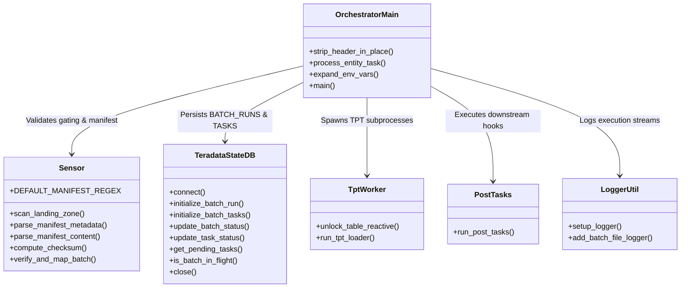

# DATA_INGESTION_ORCHESTRATOR - Technical Manual & Codebase Inventory

## 1. Internal Architecture & Component Structure

The **DATA_INGESTION_ORCHESTRATOR** repository is structured as a modular Python package:

```
DATA_INGESTION_ORCHESTRATOR/
├── orchestrator.py               # Master Pipeline Supervisor & Concurrent Executor
├── config.json                   # Runtime pipeline configuration
├── config_template.json          # Template configuration
├── ddl_technical_tables.sql      # Teradata DDL for BATCH_RUNS & BATCH_TASKS
├── entity_mapping.csv            # Mapping rules for signature-to-table resolution
└── lib/                          # Specialized library modules
    ├── sensor.py                 # Landing zone scanner, manifest parsing & gating
    ├── db_state.py               # Teradata Vantage state machine database interface
    ├── tpt_worker.py             # Subprocess execution & Error 2652 lock recovery
    ├── post_tasks.py             # Post-ingestion hooks (shell / dbt)
    └── logger.py                 # Dual stream & batch-specific file logging
```



---

## 2. Complete Module & Function Inventory

### 2.1 Entrypoint: `orchestrator.py`
- **Path**: `orchestrator.py`
- **Role**: Master batch ingress controller, concurrency driver, archive manager.

#### Functions in `orchestrator.py`:
1. `strip_header_in_place(file_path: str) -> None`
   - **Signature**: `strip_header_in_place(file_path)`
   - **Description**: Strips line 1 (header) from a delimited text file in-place using a `.tmp` swap file. Writes `.<filename>.header_stripped` marker file to ensure idempotency across retries.
   - **Side Effects**: Modifies file in-place; creates marker file.

2. `process_entity_task(entity, entity_info, batch_id, extract_timestamp, tpt_config, orch_config, db) -> bool`
   - **Signature**: `process_entity_task(...)`
   - **Description**: ThreadPool worker target. Handles decompression (`.zip`/`.gz`), determines single vs multi-chunk layout, executes `strip_header_in_place` on chunk 1 if needed, invokes `run_tpt_loader()`, and returns task success boolean.

3. `expand_env_vars(data: Any) -> Any`
   - **Signature**: `expand_env_vars(data)`
   - **Description**: Recursively expands `${VAR}` or `$VAR` environment variables in configuration strings, dictionaries, and lists.

4. `main() -> None`
   - **Signature**: `main()`
   - **Description**: Execution entrypoint. Enforces single-batch gating, moves files from `LANDING_ZONE` to `LOADING_ZONE`, registers database state, dispatches tasks to `ThreadPoolExecutor`, evaluates completion barrier, executes post-tasks, moves completed batch to `ARCHIVE_ZONE`, and commits final batch status.

---

### 2.2 Module: `lib/sensor.py`
- **Path**: `lib/sensor.py`
- **Role**: Gating enforcement, manifest parsing, checksum computation, and entity mapping.

#### Functions in `lib/sensor.py`:
1. `scan_landing_zone(landing_zone: str, manifest_pattern: str = "MANIFEST_*.MF") -> Tuple[str, Optional[str], List[str]]`
   - **Description**: Inspects directory contents. Returns status (`'IDLE'`, `'ERROR_MISSING_MANIFEST'`, `'ERROR_MULTIPLE_MANIFESTS'`, `'OK'`), manifest path, and data files list.

2. `parse_manifest_metadata(manifest_path: str, manifest_regex: Optional[str] = None) -> Dict[str, str]`
   - **Description**: Extracts `source`, `extract_timestamp`, and `batch_id` from filename. Normalizes timestamp to `YYYY-MM-DD HH:MM:SS`.

3. `parse_manifest_content(manifest_path: str) -> List[Dict[str, Optional[str]]]`
   - **Description**: Reads manifest CSV content. Extracts `filename` and `checksum` pairs. Ignores comments and empty lines.

4. `compute_checksum(filepath: str, algorithm: str = "auto") -> str`
   - **Description**: Reads file in 64 KB blocks and computes cryptographic MD5 or SHA256 checksum.

5. `verify_and_map_batch(landing_zone, manifest_entries, mapping_file, verify_checksum=True, allow_orphan_files=False, source=None) -> Tuple[Dict, List]`
   - **Description**: Verifies all files exist and are $>0$ bytes, validates checksums, rejects unmanifested orphan files (OPS-01), matches files to target tables via `entity_mapping.csv`, and returns structured workload mapping.

---

### 2.3 Module: `lib/db_state.py`
- **Path**: `lib/db_state.py`
- **Role**: State persistence in Teradata Vantage (`BATCH_RUNS` and `BATCH_TASKS`).

#### Class: `TeradataStateDB`
- **Methods**:
  1. `connect() -> None`: Establishes session to Teradata Vantage using `teradatasql`. Supports `$tdwallet`, property files, or environment overrides.
  2. `initialize_batch_run(batch_id, source, extract_timestamp) -> None`: Inserts or updates a row in `BATCH_RUNS` with `STATUS = 'RUNNING'` and `PROCESS_PID = os.getpid()`. Formats dates strictly to `YYYY-MM-DD` and `YYYY-MM-DD HH:MM:SS` to avoid Teradata Error 5404.
  3. `initialize_batch_tasks(batch_id, source, extract_timestamp, entities_workload) -> None`: Inserts pending task records into `BATCH_TASKS`.
  4. `update_batch_status(batch_id, status) -> None`: Commits terminal status (`SUCCESS` or `FAILED`), sets `END_TIME`, and preserves `PROCESS_PID` permanently without overwriting it to `NULL` (maintaining historical auditability).
  5. `update_task_status(batch_id, entity_name, file_name, status, error_message=None, retry_count=0) -> None`: Updates task record status and retry counters.
  6. `get_pending_tasks(batch_id) -> List[Tuple]`: Retrieves unfinished entity tasks for in-flight recovery.
  7. `is_batch_in_flight(batch_id) -> bool`: Checks if a batch was previously started and remains uncompleted.
  8. `close() -> None`: Safely commits and closes database sessions.

---

### 2.4 Module: `lib/tpt_worker.py`
- **Path**: `lib/tpt_worker.py`
- **Role**: Manages child process execution of `TPT_LOADER/load_csv_generic.sh` and reactive lock recovery.

#### Functions in `lib/tpt_worker.py`:
1. `unlock_table_reactive(entity: str, unlock_script: str, load_mode: str, tpt_config: dict, tpt_env: dict, logger) -> bool`
   - **Description**: Invoked when TPT fails with Error 2652 (table locked/paused). Executes `unlock_tpt_table.sh -t <entity> -m <load_mode>` to release MultiLoad or resume FastLoad.
   - **Return**: `True` if unlocked successfully; `False` otherwise.

2. `run_tpt_loader(...) -> Tuple[int, bool]`
   - **Description**: Assembles CLI command for `load_csv_generic.sh`, sets up environment variables, and launches subprocess. Decodes output using `errors='replace'`. If Error 2652 is encountered, invokes reactive unlock and retries. Updates `BATCH_TASKS` in Teradata.
   - **Return**: `(return_code: int, success: bool)`.

---

### 2.5 Module: `lib/post_tasks.py`
- **Path**: `lib/post_tasks.py`
- **Role**: Executes chained post-ingestion tasks upon 100% batch ingestion success.

#### Functions in `lib/post_tasks.py`:
1. `run_post_tasks(post_tasks_config: List[Dict], batch_metadata: Dict, logger) -> bool`
   - **Description**: Iterates through configured post-tasks. Supports task type `"shell"` and `"dbt"`. Merges tasks from Orchestrator `config.json` with source-specific tasks passed via `--post-tasks-file <FILE>`. Substitutes batch placeholders (e.g. `{batch_id}`, `$CURRENT_BATCH_ID`, `{source}`, `{extract_timestamp}`) into commands. Executes via `subprocess.run()`. Returns `True` if all tasks succeed. Bypassed cleanly when `--skip-post-tasks` is specified.

---

### 2.6 Module: `lib/logger.py`
- **Path**: `lib/logger.py`
- **Role**: Centralized and batch-specific logging setup.

#### Functions in `lib/logger.py`:
1. `setup_logger() -> logging.Logger`: Configures base console stream logger.
2. `add_batch_file_logger(logger, logs_dir, source, extract_timestamp, batch_id) -> Tuple[str, logging.FileHandler]`: Adds dedicated file handler formatted as `orchestrator_<SOURCE>_<TS>_<BATCH_ID>_<RUN_TS>.log`.

---

## 3. Teradata State Machine Database DDL

State tables are created in `${TDENV}SIDFINTCH`:

```sql
CREATE MULTISET TABLE DEV0SIDFINTCH.BATCH_RUNS ,NO FALLBACK ,
     NO BEFORE JOURNAL,
     NO AFTER JOURNAL,
     CHECKSUM = DEFAULT,
     DEFAULT MERGEBLOCKRATIO
     (
        BATCH_ID VARCHAR(100) CHARACTER SET UNICODE NOT CASESPECIFIC NOT NULL,
        SOURCE VARCHAR(50) CHARACTER SET UNICODE NOT CASESPECIFIC NOT NULL,
        EXTRACT_TIMESTAMP VARCHAR(50) CHARACTER SET UNICODE NOT CASESPECIFIC,
        RUN_DATE DATE FORMAT 'YYYY-MM-DD',
        START_TIME TIMESTAMP(0),
        END_TIME TIMESTAMP(0),
        STATUS VARCHAR(20) CHARACTER SET UNICODE NOT CASESPECIFIC NOT NULL,
        PROCESS_PID INTEGER
     )
PRIMARY INDEX ( BATCH_ID ,SOURCE );

-- Migration for existing environments:
-- ALTER TABLE DEV0SIDFINTCH.BATCH_RUNS ADD PROCESS_PID INTEGER;

CREATE MULTISET TABLE DEV0SIDFINTCH.BATCH_TASKS ,NO FALLBACK ,
     NO BEFORE JOURNAL,
     NO AFTER JOURNAL,
     CHECKSUM = DEFAULT,
     DEFAULT MERGEBLOCKRATIO
     (
        BATCH_ID VARCHAR(100) CHARACTER SET UNICODE NOT CASESPECIFIC NOT NULL,
        SOURCE VARCHAR(50) CHARACTER SET UNICODE NOT CASESPECIFIC NOT NULL,
        EXTRACT_TIMESTAMP VARCHAR(50) CHARACTER SET UNICODE NOT CASESPECIFIC,
        ENTITY_NAME VARCHAR(100) CHARACTER SET UNICODE NOT CASESPECIFIC NOT NULL,
        FILE_NAME VARCHAR(500) CHARACTER SET UNICODE NOT CASESPECIFIC NOT NULL,
        STATUS VARCHAR(20) CHARACTER SET UNICODE NOT CASESPECIFIC NOT NULL,
        START_TIME TIMESTAMP(0),
        END_TIME TIMESTAMP(0),
        RETRY_COUNT INTEGER DEFAULT 0,
        ERROR_MESSAGE VARCHAR(1000) CHARACTER SET UNICODE NOT CASESPECIFIC
     )
PRIMARY INDEX ( BATCH_ID ,SOURCE );
```
